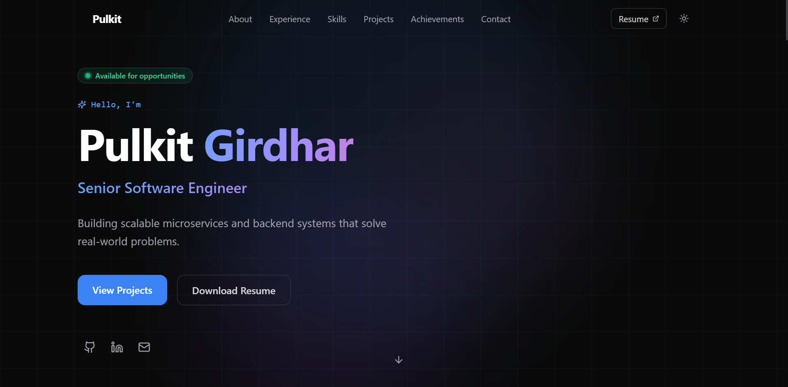

# pulkit-0103.dev

My personal portfolio — built with Next.js 15, TypeScript, Tailwind CSS, and Framer Motion. Fully config-driven: every section is populated from a single file so the entire site can be updated without touching component code.

**Live:** [pulkit-0103.vercel.app](https://pulkit-0103.vercel.app)

<p align="center">
  
</p>

---

## Tech Stack

| Layer         | Choice                                 |
| ------------- | -------------------------------------- |
| Framework     | Next.js 15 (App Router, React 19)      |
| Language      | TypeScript                             |
| Styling       | Tailwind CSS v3                        |
| Animations    | Framer Motion + native CSS keyframes   |
| Icons         | react-icons, lucide-react              |
| Themes        | next-themes (dark default, light toggle) |
| Deployment    | Vercel                                 |

## Features

- Config-driven content (`src/config/site.ts`)
- Custom cursor (dot + smoothly-trailing ring, scales on interactive elements)
- Scroll-triggered section reveals via `IntersectionObserver`
- Staggered card animations in Skills, Experience, Projects, and Achievements
- Real tech-brand logos on skill badges (Java, Spring Boot, Docker, AWS, etc.)
- Real company logo for experience (Accenture)
- Open Source and Blog sections auto-hide when their arrays are empty
- Security headers wired in `next.config.ts` (CSP, HSTS, X-Frame-Options, etc.)
- Production browser source maps disabled

## Getting Started

Prerequisites: **Node.js 20+**

```bash
# Install dependencies
npm install

# Run the dev server
npm run dev

# Production build
npm run build && npm start
```

Open [http://localhost:3000](http://localhost:3000).

## Configuration

Everything user-facing lives in **`src/config/site.ts`**:

| Field                    | What it controls                                  |
| ------------------------ | ------------------------------------------------- |
| `name`, `initials`, `tagline`, `roles` | Hero identity + cycling role animation |
| `email`, `linkedin`, `github`, `twitter` | Social + contact links                 |
| `resumeUrl`              | Resume download link — Google Drive (primary)    |
| `resumeLocalUrl`         | Self-hosted fallback PDF, built by CI from `resume/` |
| `photo`                  | Path to profile photo in `/public`               |
| `about`                  | Bio paragraphs, location, availability badge     |
| `experience`             | Work history (renders as timeline)               |
| `education`              | Academic history                                 |
| `skills`                 | Grouped by category (Languages, Backend, etc.)   |
| `projects`               | Project cards with tech badges + GitHub/live links |
| `achievements`           | Competitive programming, certifications, scholarships |
| `openSource`, `blog`     | Empty arrays hide the sections                   |

## Project Structure

```
src/
├── app/
│   ├── globals.css        # Tailwind + custom animations + cursor styles
│   ├── layout.tsx         # Root layout, ThemeProvider, CustomCursor
│   └── page.tsx           # Section composition
├── components/            # One file per section + shared UI
├── config/
│   └── site.ts            # ← All content lives here
└── lib/
    └── icons.tsx          # Icon mappings (skills, companies, platforms)

public/                    # Static assets (photo, resume PDF)
next.config.ts             # Security headers, source-map policy
```

## Deployment

Push to GitHub, connect the repo to [Vercel](https://vercel.com), and it auto-deploys on every commit to `main`. No environment variables required.

## License

[MIT](./LICENSE)

